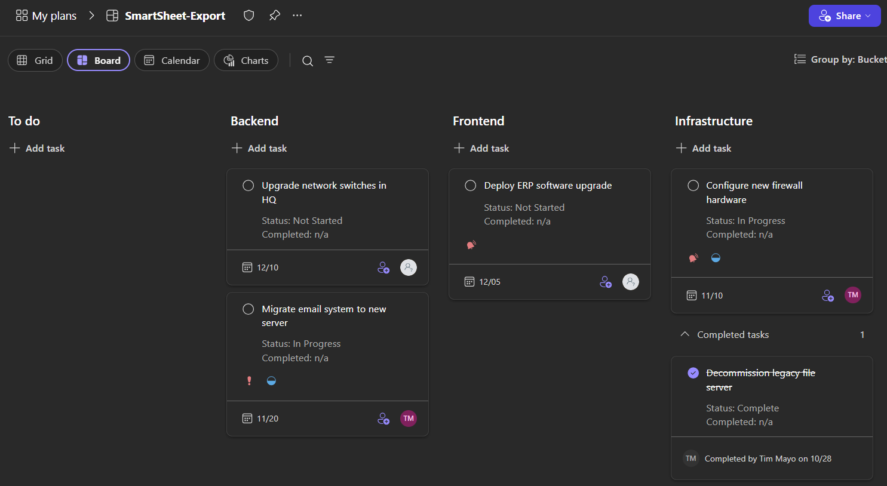

# Smartsheet to Planner

## Use case

A Power Automate flow reads a Smartsheet sheet and rebuilds it in Microsoft Planner, so a team that tracks work in Smartsheet can move to Planner without re-entering tasks by hand. It runs in GCC and is designed for repeated runs: rows already exported are updated, not duplicated.

Each run does three things:

- Saves a CSV copy of the sheet to SharePoint.
- Creates any Planner buckets the sheet names that the plan does not yet have.
- Creates one Planner task per sheet row, or updates the task if that row was exported before.

## How it works

You keep your task list in a Smartsheet sheet with columns for task name, bucket, start date, end date, priority, status and completion date. The flow reads that sheet each time it runs and keeps a Planner plan in step with it. A SharePoint list remembers which Planner task belongs to which sheet row, which is how re-runs update tasks instead of duplicating them.

## What you need

- Power Automate with the Smartsheet, Planner and SharePoint connectors (built and tested in GCC)
- A Smartsheet sheet with the columns described in "How it works"
- A Planner plan (basic & group-connected) and a SharePoint site and list for the row-to-task mapping

## Expected output

A successful run produces four things.

1. **A CSV file in SharePoint** with the sheet's rows (the Scope-ExportCsv actions Create-CsvTable and Create-CsvFile).
2. **Planner buckets** matching the distinct values in the sheet's Bucket column. Missing buckets are created; existing ones are reused (matched case-insensitively).
3. **Planner tasks**, one per sheet row, placed in the bucket named on that row.
4. **A SharePoint mapping list** with one item per created task, linking the sheet row key to the Planner task ID. On the next run, a row found in this list updates its task instead of creating a new one.

The resulting Planner board, grouped by bucket:

