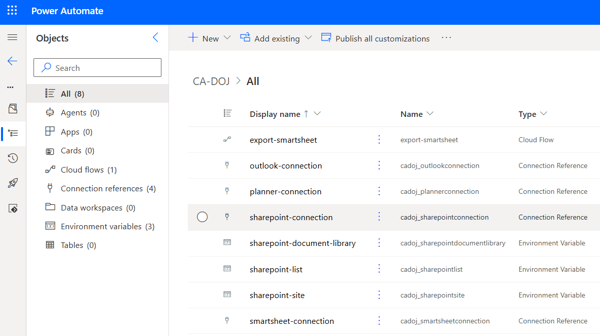

# Setup

Follow these steps in order. The items marked **Watch out** are the ones most likely to cause a failed run.

## 1. What you need

| Requirement | Notes |
| --- | --- |
| Power Automate environment with Dataverse | The flow is imported as a solution. |
| Connectors: Smartsheet, Microsoft Planner, SharePoint | Confirm the licensing for each in your tenant. |
| A Smartsheet account with access to the sheet | You need at least read access to the sheet. |
| A Planner plan in a Microsoft 365 group | The flow creates buckets and tasks in this plan. |
| A SharePoint site | Holds the CSV export and the mapping list. |

This project was built and tested in Commercial & GCC.

## 2. Prepare the Smartsheet sheet

The flow reads columns by their exact titles. A different title means that field comes through empty, or the run fails.

| Column title | Type | Used for |
| --- | --- | --- |
| `TaskName` | Text | Planner task title. Also used as the row key (see below). |
| `Bucket` | Text | Planner bucket name. |
| `StartDate` | Date | Task start date. |
| `EndDate` | Date | Task due date. |
| `Assignee` | Contact list | List of people to assign. |
| `CompleteDate` | Date | Shown in the task description. |
| `Status` | Dropdown | Percent complete and description. |
| `Priority` | Dropdown | Planner priority. |

**Watch out**

- **Column titles are exact and case-sensitive.** `Task`, `Task Name`, `Start Date` and `DueDate` do not match. Use `TaskName`, `StartDate` and `EndDate`.
- **Every row needs a `Bucket` value.** Buckets are created from these values. Matching is case-insensitive, but the names must otherwise be identical (`Back end` and `Backend` are different buckets).
- **Use these exact `Status` values:** `Not Started`, `In Progress`, `Blocked`, `Complete`. `Complete` becomes 100%, `In Progress` becomes 50%, anything else becomes 0%.
- **Use these exact `Priority` values:** `Critical`, `High`, `Medium`, `Low`. Anything else becomes Planner priority 5.

Note the sheet ID. In Smartsheet, open the sheet and choose **File > Properties**. You will need it in step 5.

## 3. Prepare SharePoint

1. Create (or pick) a SharePoint site for the project.
2. Create a document library location for the CSV export.
3. Create a list for the row-to-task mapping, with these columns in addition to the default `Title`:

| Column | Type |
| --- | --- |
| `SmartSheetRowKey` | Single line of text |
| `PlannerTaskId` | Single line of text |

**Watch out**

- Create the column names exactly as shown. SharePoint fixes a column's internal name when the column is created, and renaming it later does not change that internal name.
- **Do not delete items from this list.** The list is how the flow knows a row was already exported. If an item is removed, the next run creates a duplicate task for that row.

## 4. Prepare Planner

1. Create a plan in a Microsoft 365 group.
2. Note the **group ID** (the Microsoft 365 group's object ID, visible in Microsoft Entra ID or the Microsoft 365 admin center).
3. Note the **plan ID**. Open the plan in the browser and copy the value after `planId=` in the URL.

You do not need to create buckets. The flow creates them.

## 5. Import and configure the flow

1. Import the solution that contains the flow (Power Apps > Solutions > Import solution).

3. When prompted, create or select a connection for each connector: Smartsheet, Planner and SharePoint.
4. Set the solution parameters for the SharePoint site and the SharePoint list from step 3.
5. Open the flow and set the variables near the top (these are variables in case you want multiple copies of the flow in the same solution):
   - `varSheetId`: the Smartsheet sheet ID from step 2.
   - `varGroupId`: the group ID from step 4.
   - `varPlanId`: the plan ID from step 4.
6. Turn the flow on.

**Watch out**

- **Do not rename actions.** Later actions refer to earlier ones by name (for example `Get-SheetData`, `Filter-BucketForRow`).

## 6. Run and verify

1. Run the flow with **Test**.
2. Open the run and confirm every action is green.
3. In Planner, check the board (grouped by bucket) for the new buckets and tasks.
4. In SharePoint, check that the CSV file exists and the mapping list has one item per task.
5. Run the flow again. No new tasks should appear; the existing ones are updated.
